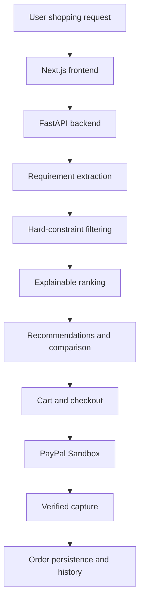

# AgentCart 🛒

**An AI-powered shopping assistant that understands what you need, compares products against your requirements, and supports secure PayPal Sandbox checkout.**

AgentCart turns natural-language shopping requests into structured requirements, filters products using hard constraints, and ranks eligible options using explainable scoring. It also supports product comparison, shopping-session continuity, cart management, and order tracking.

> **Demo project:** AgentCart uses a labelled demo product catalog and PayPal Sandbox. It is not a live e-commerce store. Product prices are demo data, and successful payment status is recorded only after verified PayPal capture.

## ✨ Features

- **Natural-language shopping:** Describe your needs in plain English instead of relying only on filters.
- **AI-assisted requirement extraction:** Uses Groq to extract structured shopping requirements, with a labelled rule-based fallback when AI is unavailable.
- **Hard-constraint filtering:** Disqualifies products that violate requirements such as budget, minimum specifications, or excluded brands before ranking.
- **Explainable product ranking:** Ranks eligible products using weighted criteria and available product attributes.
- **Product comparison:** Compare multiple products side by side, including their specifications and trade-offs.
- **Dynamic reranking:** Adjust ranking priorities and recalculate recommendations.
- **Shopping sessions:** Maintains session-specific shopping context and order history.
- **Cart and checkout:** Supports product and cart checkout flows through PayPal Sandbox.
- **Payment reliability:** Uses server-side product prices, idempotency controls, capture verification, and order reconciliation to handle checkout failures safely.
- **Order management:** View order status and continue eligible checkout or reconciliation flows.

## 🧠 How It Works

1. **Understand intent** — Extract requirements such as category, budget, preferred specifications, and exclusions.
2. **Filter candidates** — Apply hard constraints in the backend before calculating recommendation scores.
3. **Rank products** — Score eligible products using available attributes and configurable weights.
4. **Explain trade-offs** — Present recommendations with advantages, disadvantages, and missing information rather than inventing specifications.
5. **Checkout securely** — Create and capture PayPal Sandbox orders using server-side pricing and verified payment status.

### Architecture



## 🛠️ Tech Stack

| Layer | Technologies |
|---|---|
| Frontend | Next.js, React, TypeScript, Tailwind CSS |
| Backend | Python, FastAPI, Pydantic |
| AI | Groq API, rule-based fallback |
| Database | SQLite, SQLAlchemy, Alembic |
| Payments | PayPal REST API — Sandbox |
| Testing | Pytest |
| Tooling | Git, GitHub, Postman, Docker Compose |

## 📁 Project Structure

```text
AgentCart/
├── backend/
│   ├── app/
│   │   ├── routers/
│   │   ├── services/
│   │   └── ...
│   ├── tests/
│   └── ...
├── frontend/
│   ├── app/
│   ├── components/
│   └── lib/
├── docs/
├── postman/
├── .env.example
├── docker-compose.yml
└── README.md
```

## 🚀 Getting Started

### Prerequisites

- Python 3.12
- Node.js 20+
- npm
- [uv](https://docs.astral.sh/uv/) for Python dependency management

### 1. Clone the repository

```bash
git clone https://github.com/aryanCodes17/AgentCart.git
cd AgentCart
```

### 2. Configure environment variables

```bash
copy .env.example .env
```

Edit `.env` and configure the integrations you want to use.

| Variable | Purpose |
|---|---|
| `GROQ_API_KEY` | Enables Groq-powered requirement extraction |
| `AI_PROVIDER` | AI provider selection; configured as `groq` |
| `PAYPAL_CLIENT_ID` | PayPal Sandbox application client ID |
| `PAYPAL_CLIENT_SECRET` | PayPal Sandbox application secret |
| `PAYPAL_BASE_URL` | PayPal Sandbox API base URL |
| `PAYPAL_INR_PER_USD` | Documented demo INR-to-USD conversion rate |
| `DATABASE_URL` | Database connection string |

Groq and PayPal credentials are optional for local demo exploration. Without an AI key, the application uses its labelled rule-based fallback. PayPal checkout requires valid Sandbox credentials.

**Never commit your `.env` file or real API credentials.**

### 3. Start the backend

```bash
cd backend
uv sync --group dev
uv run uvicorn app.main:app --reload --port 8000
```

Backend API: http://localhost:8000

Interactive API documentation: http://localhost:8000/docs

Health endpoint: http://localhost:8000/api/health

### 4. Start the frontend

Open another terminal:

```bash
cd frontend
npm install
npm run dev
```

Frontend: http://localhost:3000

### 5. Run backend tests

```bash
cd backend
uv run pytest -q
```

### 6. Build the frontend

```bash
cd frontend
npm run lint
npm run build
```

## 💳 PayPal Sandbox Checkout

AgentCart integrates with the official PayPal Checkout REST API.

1. Create a Sandbox REST application in the PayPal Developer Dashboard.
2. Add the Sandbox client ID and secret to `.env`.
3. Configure the Sandbox API base URL:

   ```env
   PAYPAL_BASE_URL=https://api-m.sandbox.paypal.com
   ```

4. Use a PayPal Sandbox buyer account to approve test payments.
5. AgentCart verifies the capture response before marking an order as paid.

**Payment safeguards:**
- Prices are retrieved from backend catalog data, not trusted from the client.
- Checkout requests use idempotency keys to reduce duplicate order creation.
- Capture attempts are guarded against duplicate processing.
- Ambiguous payment outcomes can be reconciled against PayPal.
- An order is marked paid only after a completed capture with a valid capture ID.

Catalog prices are in INR, while the Sandbox payment flow uses USD. The configured conversion rate is a documented demo rate, not a live foreign-exchange feed.

## 🔌 API Overview

The backend exposes endpoints for:

- Health and public application settings
- Product catalog and product details
- AI-assisted shopping search and follow-up messages
- Product comparison and reranking
- Shopping sessions and recommendations
- PayPal order creation, capture, and cancellation
- Order history, order details, and reconciliation

Explore the complete request and response schemas at:

`http://localhost:8000/docs`

## ⚠️ Important Notes

- The product catalog is demo data.
- Product recommendations are limited by the attributes available in the catalog.
- Missing specifications are treated as unknown, not guessed.
- PayPal integration runs in Sandbox mode; no real payments are processed.
- The configured currency conversion is for demonstration only.

## 👨‍💻 Author

**Aman Aryan**

[GitHub](https://github.com/aryanCodes17) · [Project Repository](https://github.com/aryanCodes17/AgentCart)

---

*Built as an AI-powered shopping agent project exploring intent understanding, explainable recommendations, and reliable payment workflows.*
